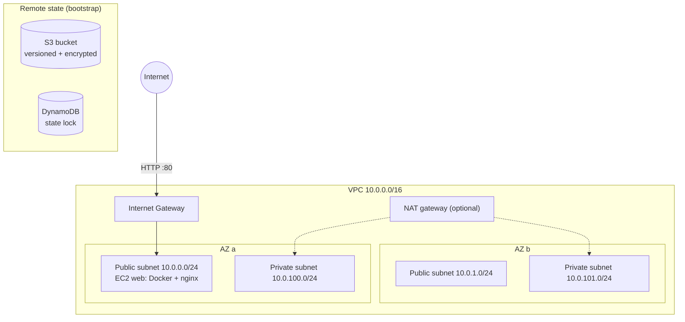

# terraform-aws-infra

[](https://github.com/n6jannat/terraform-aws-infra/actions/workflows/terraform-ci.yml)

Modular Terraform for a small AWS web stack: a multi-AZ VPC, a hardened EC2 web server running nginx in Docker, and an S3 + DynamoDB remote-state backend. It can be tested end to end **without an AWS account** using [LocalStack](https://www.localstack.cloud/), and CI applies it against LocalStack on every push.

## Architecture



## Repository layout

```
.
├── bootstrap/            # one-time: S3 state bucket + DynamoDB lock table
├── modules/
│   ├── vpc/              # VPC, public/private subnets per AZ, IGW, optional NAT, route tables
│   └── ec2-web/          # security group + EC2 (IMDSv2, encrypted gp3, Docker/nginx user_data)
├── envs/
│   ├── local/            # LocalStack target — free, no AWS account
│   └── dev/              # real AWS target, S3 remote backend
├── .github/workflows/    # CI: fmt, validate, tflint, apply/destroy on LocalStack
├── docker-compose.yml    # LocalStack
└── Makefile
```

## What it shows

- **Reusable modules** with input validation, typed variables, and outputs
- **Environment separation** (`local`, `dev`) calling the same modules
- **Remote state** in S3 with versioning, encryption, public-access block and DynamoDB locking
- **Security defaults**: IMDSv2 required, encrypted root volume, SSH closed unless you pass your own IP
- **Cost awareness**: NAT gateway off by default, `t3.micro` instance
- **CI/CD**: GitHub Actions runs `fmt`, `validate`, `tflint`, then a real `apply` + `destroy` against LocalStack
- **Bootstrap script** that installs Docker, runs nginx, and logs a warning when the root disk passes 80%

## Quick start — no AWS account (LocalStack)

Requirements: Docker, Terraform ≥ 1.5.

```bash
docker compose up -d                 # start LocalStack on :4566
cd envs/local
terraform init
terraform apply                      # creates VPC, subnets, SG, EC2 in LocalStack
terraform output
terraform destroy
docker compose down
```

Or simply `make local-apply` / `make local-destroy`.

## Deploy to real AWS (dev)

```bash
aws configure                        # your own credentials

# 1. one-time remote state
cd bootstrap
terraform init && terraform apply    # note the state_bucket output

# 2. dev environment
cd ../envs/dev
cp backend.hcl.example backend.hcl            # fill in bucket from step 1
cp terraform.tfvars.example terraform.tfvars  # set your IP for SSH, etc.
terraform init -backend-config=backend.hcl
terraform plan
terraform apply
# open http://<web_public_ip>

terraform destroy                    # avoid charges when done
```

> `enable_nat_gateway = true` adds a NAT gateway, which AWS bills hourly. Leave it off for demos.

## Roadmap

- [ ] Application Load Balancer + Auto Scaling Group module
- [ ] EKS module with managed node group
- [ ] OIDC-based GitHub Actions role for `plan` against real AWS
- [ ] Checkov / tfsec security scanning in CI
